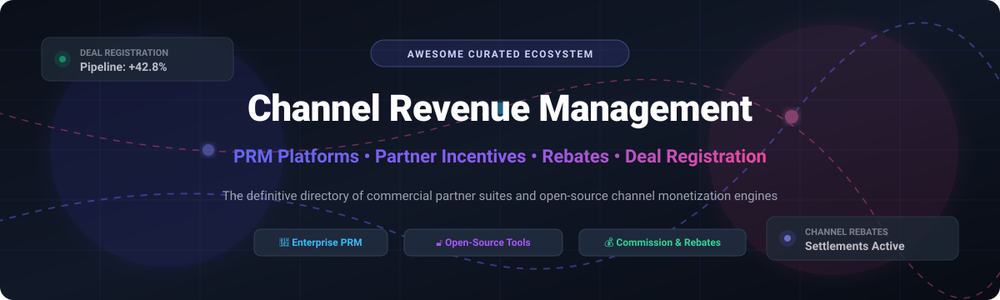

# Awesome-Channel-Revenue-Management

# Awesome-Channel-Revenue-Management 🏢 💰



  





  
  
  
  
  
  



---

## 🌟 Top Channel Revenue Management Ecosystem

**Curated List of Commercial Partner Revenue Platforms & Open-Source Channel Management Tools**  
*Focused on Deal Registration, Partner Onboarding, Commission Management, Rebate Processing, Channel Pipeline Visibility & Self-Hosted Partner Programs*

**Last updated: October 2026** 📅

---

### 📌 Overview & SEO Summary
Welcome to the ultimate curated directory of **channel revenue management platforms**, **partner relationship management (PRM) systems**, and **open-source channel incentive tools**. Whether you are looking for enterprise-grade commercial solutions (such as *Salesforce Partner Cloud*, *Model N*, and *Impartner*), or self-hostable open-source alternatives (like *xAmplify OpenSource PRM*, *Refferq*, and *BiznisBox*), this list covers category leaders, deal registration workflows, and privacy-respecting channel operations.

**Key Market Context:**
- **Salesforce, Oracle and HubSpot were ranked the top three overall leaders** in ISG's 2026 Partner Relationship Management Buyers Guide, with **HubSpot, Microsoft, Oracle, Salesforce and Zoho rated Exemplary** for performing above median in both Product and Customer Experience .
- **Impartner PRM is well-regarded among large vendors running structured, multi-tier reseller programs**, though users note **on-demand learning resources are limited** and some portal sections require support tickets to adjust .
- **xAmplify launched an open-source PRM platform** in September 2025 — a free, community-driven foundation for partner onboarding, deal registration, and core reporting, designed to reduce vendor lock-in for smaller partner programs .
- **Refferq is an open-source referral and affiliate marketing platform** for SaaS businesses with automated commission calculations, flexible commission rules (percentage-based and fixed), payout scheduling (NET-15, NET-30), and multiple payout methods (PayPal, Bank Transfer, Stripe, Wise) .
- **BiznisBox is an open-source all-in-one business management platform** with partner management, invoice and quote management, payment tracking, contract management, and multi-language support (English, French, Spanish) under AGPL-3.0 .
- **Odoo's OCA commission modules** provide **sales commissions, account commissions, HR commissions, commission formulas, and product criteria-based commissions** for building channel incentive logic on top of Odoo Community .
- **Odoo's Agreement Rebate module** extends agreement functionality to define **rebate conditions** with basic global rappel discounts, line-item rappels, and section-based rappel rules — enabling channel rebate settlement workflows .
- **Opencell is an open-source agile monetization platform** used by over 30 customers worldwide for subscription and usage-based billing, with quote, billing, collection, report, and customer care modules — applicable to channel partner billing and settlement .

---

## 📑 Table of Contents
- [🏢 SaaS & Commercial Platforms](#-saas--commercial-platforms)
- [🔓 Open-Source GitHub Projects](#-open-source-github-projects)
- [🛠️ How to Contribute](#%EF%B8%8F-how-to-contribute)
- [📊 Star History](#-star-history)
- [🤝 Support & Sponsorship](#-support--sponsorship)
- [⚠️ Disclaimer](#%EF%B8%8F-disclaimer)

---

## 🏢 SaaS / Commercial Platforms

The channel revenue management market spans **enterprise PRM suites** (Salesforce Partner Cloud, Oracle PRM) that provide **deal registration, partner onboarding, and pipeline visibility**, **channel incentive platforms** (Model N, Vistex) that focus on **rebate management, chargebacks, and revenue recognition**, and **SaaS-focused partner platforms** (PartnerStack, Impartner) that emphasize **affiliate networks and self-serve partner portals**. **Salesforce was ranked the top overall leader** in ISG's 2026 PRM Buyers Guide . **Impartner** uses **custom enterprise pricing** with **multi-tier reseller program support** .

| SaaS / Commercial Platform | Company / Owner | Valuation / Market Cap | Standard Edition Starting Price | Free Tier / Free Trial Limits | Description |
| :--- | :--- | :--- | :--- | :--- | :--- |
| **[Salesforce Partner Cloud](https://www.salesforce.com/)** ☁️ | Salesforce | ~$250 Billion | **Custom enterprise pricing** | **No free tier**; demo available | **Enterprise PRM leader** — **Ranked top overall in ISG 2026 PRM Buyers Guide** with **Leader scores in five categories** . **Deal registration, partner onboarding, pipeline visibility, and governed collaboration across channel ecosystems**. **Exemplary rating for above-median Product and Customer Experience** . |
| **[Oracle PRM](https://www.oracle.com/)** 🔴 | Oracle | ~$300 Billion | **Custom enterprise pricing** | **No free tier**; demo available | **Enterprise channel management** — **Ranked #2 overall in ISG 2026** with **Leader scores in five categories** . **Exemplary rating** for Product and Customer Experience. **Deep integration with Oracle Fusion Cloud and NetSuite** . |
| **[HubSpot PRM](https://www.hubspot.com/)** 🟠 | HubSpot | ~$30 Billion | **Custom pricing** | **Free tier: limited CRM features** | **CRM-native partner management** — **Ranked #3 overall in ISG 2026** with **Exemplary rating** . **Partner onboarding, deal registration, and pipeline visibility integrated with HubSpot CRM** . |
| **[Model N](https://www.modeln.com/)** 🎯 | Model N | ~$1 Billion | **Custom enterprise pricing** | **No free tier**; demo available | **Revenue management for life sciences and high-tech** — **Channel rebates, chargebacks, and government pricing**. **Complex channel incentive management** . |
| **[Vistex](https://www.vistex.com/)** 📊 | Vistex | Private | **Custom enterprise pricing** | **No free tier**; demo available | **Channel revenue and incentive management** — **Rebates, chargebacks, and trade promotion management**. **SAP-native integration** . |
| **[Impartner PRM](https://www.impartner.com/)** 🔵 | Impartner | Private | **Custom enterprise pricing** | **No free tier**; demo available | **Enterprise partner management** — **Multi-tier reseller programs, deal registration, and partner portal** . **Rated Merit in ISG 2026** . **Limitations: limited on-demand learning resources, some portal sections require support tickets** . |
| **[PartnerStack](https://partnerstack.com/)** 🟢 | PartnerStack | Private | **Custom pricing** | **Free trial available** | **SaaS partner ecosystem platform** — **Connects SaaS companies with B2B partners out of the gate** . **Affiliate and reseller network with clean partner dashboard** . |
| **[ZINFI Unified Partner Management](https://www.zinfi.com/)** 🟣 | ZINFI | Private | **Custom pricing** | **Free trial available** | **Unified partner management** — **Partner onboarding, training, certifications, co-branded campaign templates, and marketing assets** . **Strong for remote teams across time zones** . |
| **[Mindmatrix PRM](https://www.mindmatrix.net/)** 🟡 | Mindmatrix | Private | **Custom pricing** | **Demo available** | **Partner enablement with marketing automation** — **Combines PRM with advanced marketing automation** for businesses prioritizing both . **Rated Merit in ISG 2026** . |
| **[Channeltivity](https://channeltivity.com/)** 🟠 | Channeltivity | Private | **Custom pricing** | **Demo available** | **Mid-market channel management** — **Solid deal registration, MDF management, and partner portal capabilities** . **Best for channel-focused teams that want mid-market-friendly pricing** . |

---

## 🔓 Open-Source GitHub Projects

*Sorted by GitHub_Stars_Count (Descending)* 🌟

- **[xAmplify OpenSource PRM](https://github.com/xAmplify/xAmplify-OpenSource-PRM)**   
  **Free, open-source foundation for partner relationship management**, open-source. **Launched September 2025** as a **community-driven PRM platform** . **Partner onboarding, deal registration, and core reporting** — **host it, customize it, run it your way, no strings attached** . **Modular, adaptable architecture** supporting **managed service providers, distributors, resellers, and custom partner models** . **Designed to reduce vendor lock-in** and enable **greater innovation across partner programs** . **Seamlessly move to xAmplify Cloud when ready to scale with integrations, AI, and enterprise features** . **The most complete open-source PRM platform** . 🚀

- **[Refferq](https://github.com/Refferq/Refferq)**   
  **Open-source referral and affiliate marketing platform for SaaS businesses**, open-source. **Launch your referral program in minutes** . **For Admins**: **dashboard analytics with real-time revenue tracking, conversion rate analytics, and partner performance metrics** . **Partner management**: **approve/reject affiliate applications, manage partner groups, set custom commission rates, and view partner activity logs** . **Referral management**: **review and approve lead submissions, track referral status (Pending, Approved, Rejected), and manual lead conversion tracking** . **Commission & Payouts**: **automated commission calculations, flexible commission rules (percentage-based and fixed), payout scheduling (NET-15, NET-30, etc.), and multiple payout methods (PayPal, Bank Transfer, Stripe, Wise)** . **Email automation**: **welcome emails, referral notifications, commission approval alerts, payout confirmations, and customizable templates** . **For Affiliates**: **personal dashboard with earnings overview (total, pending, paid), click tracking, lead conversion metrics, unique referral link, shareable referral code, and payout tracking** . **Tech Stack**: **Next.js 15.2.3, React 19, TypeScript, PostgreSQL, Prisma, JWT (jose), bcryptjs, Tailwind CSS, Recharts, Resend** . **The most complete open-source referral and channel incentive platform** . 🎯

- **[BiznisBox](https://github.com/biznisbox/biznisbox)**   
  **Open-source all-in-one business management platform**, AGPL-3.0 licensed. **All-in-one solution for invoices, quotes, documents, and payments** . **Partner Management** — **manage customers, suppliers, and partners** . **Invoice & Quote Management** — **create and track issued invoices and quotes** . **Payment Management** — **record issued and received payments** . **Contract Management** — **create and sign contracts digitally** . **Project Management** — **track projects and tasks** . **User Roles & Permissions** — **manage user access and permissions** . **Multi-Language Support** — **English, French, and Spanish** . **Audit Log** — **track changes with detailed history** . **Payment Gateway Integration** — **Stripe, PayPal, and Coinbase Commerce** . **Open Banking Integration** — **supports GoCardless** . **Self-Hosted** — **full control over your data and privacy** . **API Access** — **integrate with other tools and services** . **The most complete open-source channel partner business management platform** . 🏢

- **[Odoo OCA Commission](https://github.com/newcom-lcs/oca-commission)**   
  **Open-source commission management modules for Odoo**, AGPL-3.0 licensed. **The most comprehensive open-source commission management suite for channel incentives** . **Available addons**: **`account_commission`** (account commissions), **`commission`** (base commissions), **`commission_delegated_partner`** (delegate invoices to partner), **`commission_formula`** (formula-based commissions), **`hr_commission`** (HR commissions), **`sale_commission`** (sales commissions), **`sale_commission_agent_restrict`** (agent restrictions), **`sale_commission_margin`** (margin-based commissions), **`sale_commission_product_criteria`** (product criteria rules), **`sale_commission_product_criteria_country`** (country criteria), **`sale_commission_product_criteria_discount`** (discount criteria), **`sale_commission_product_criteria_domain`** (domain criteria), **`sale_commission_product_criteria_fiscal_position_type`** (fiscal position criteria), **`sale_commission_salesman`** (salesman commissions) . **The definitive open-source channel commission engine** . 💰

- **[Odoo Agreement Rebate](https://github.com/OCA/agreement)**   
  **Open-source rebate management for Odoo agreements**, AGPL-3.0 licensed. **Extends agreement module to define rebate conditions** . **Create rebate agreements with rappel types**: **Basic global rappel discount, Basic rappel discount by line items, Section rappel discount rule match, and Calculate the discount in each amount section** . **Create rebate lines and apply product template filters** . **Generate rebate settlements from Agreements > Settlements > Create Settlements wizard** . **Create rappel invoices from Agreements > Settlements > Create Invoices wizard** . **The most complete open-source channel rebate management module** . 📊

- **[Opencell](https://github.com/opencell-solutions/opencell)**   
  **Open-source agile subscription and usage monetization platform**, open-source. **Used by over 30 customers worldwide** including **Orange Cloud for Business, Bouygues Telecom, EDF, and Total Spring** . **Acquire**: **agile subscription or usage-based pricing, flexible catalog and bundles, offer simulation, instant promotions, and integrated quoting for direct and indirect sales** . **Monetize**: **custom mediation for usage events, billing, invoicing and partner management, integrated order management and provisioning, multichannel payment gateway, and integrated AR management & dunning** . **Retain**: **unified view of customer activity, upgrades, conversions and renewals, best offer management, and customer care portal** . **Report**: **subscription analytics and data warehouse, customizable dashboards, integrated revenue recognition, tax management, and G/L integration** . **Open source code, no vendor lock-in, 400+ rich APIs and third-party connectors** . **Best for telecom, cloud infrastructure, IoT, and utilities channel billing** . 🏗️

- **[Surka](https://github.com/arian-gogani/surka)**   
  **Partner cross-promotion swap management tool**, open-source. **Runs partner swaps from yes to results: terms, deadlines, reminders, proof of delivery, and a record of who keeps their word** . **Create it**: **add two businesses and write what each gives and by when — both sides must give something or Surka refuses the swap** . **Send it**: **each side gets a private link, no account needed** . **Partner answers**: **accept, suggest changes, or decline — a counter reopens terms** . **Both sides deliver**: **each side marks commitments delivered with proof (newsletter archive, live listing)** . **Check it**: **mark each commitment kept or missed against proof** . **Reputation counts commitments kept, never results** — **old outcomes fade with a 180-day half-life** . **Tech Stack**: **Node 20+, PGlite (Postgres compiled to WebAssembly), Next.js, TypeScript** . **The most innovative open-source partner collaboration tool** . 🔄

- **[SuperHertz Marketplace](https://github.com/yourusername/superhertz-marketplace)**   
  **Comprehensive multi-vendor solution for WordPress**, open-source. **Self-Service Partner Portal** — **full frontend dashboard for vendors to manage products, policies, and orders without admin access** . **Advanced Catalog Engine** — **Product Blueprints and multi-step listing wizard for consistency** . **Commercial Transaction Flow** — **sliding AJAX cart, unified master checkout, and multi-vendor split-payment readiness** . **Elementor Integration** — **15+ dedicated widgets for custom marketplace views and dynamic listing templates** . **Transaction Snapshotting** — **core logic that freezes product data at order moment for historical accuracy** . **Best for WordPress-based channel marketplaces** . 🛒

---

## 🛠️ How to Contribute

Contributions are welcome! Follow these steps to submit new channel revenue management platforms or open-source partner management software:

1. 🍴 **Fork** the repository.
2. 📝 **Add/edit** entries in `README.md` maintaining table/list structure and formatting.
3. 🔗 Include project title, official website/GitHub link, exact Stars_Count, license, and brief description.
4. 🚀 Submit a **Pull Request** with a descriptive summary of your changes.

---

## 📊 Star History



---

## 🤝 Support & Sponsorship

If you find this channel revenue management repository useful, please consider supporting the project:

- ⭐ **Star** this repository to increase visibility!
- 🔀 **Fork** and share with fellow channel leaders, partner operations teams, and open-source advocates.
- ☕ **Sponsor & Buy Me a Coffee**: Support ongoing open-source curation via the [GitHub Sponsor Dashboard](https://github.com/sponsors/ishandutta2007).

---

## ⚠️ Disclaimer

- This is a **community-curated** list — not exhaustive and not an endorsement. ℹ️
- **Salesforce, Oracle and HubSpot were ranked the top three overall leaders** in ISG's 2026 Partner Relationship Management Buyers Guide, with **Salesforce and Oracle achieving Leader scores in five categories** . **HubSpot, Microsoft, Oracle, Salesforce and Zoho were rated Exemplary** for above-median Product and Customer Experience .
- **Impartner PRM's limitations** include **limited on-demand learning resources** and **some portal sections requiring support tickets to adjust** . **xAmplify OpenSource PRM is a newer entrant** — the community aspect is intriguing, but traction and long-term support are still to be proven .
- **Open-source channel revenue tools are not turnkey** — **Refferq requires Node.js 18+, PostgreSQL 14+, and API keys for Resend email service** . **BiznisBox requires self-hosted deployment with payment gateway credentials** . **Odoo OCA Commission modules require an Odoo Community instance** . **Always validate deal registration workflows, commission calculations, and payout processing with a proof-of-concept** before production deployment. 🏢

---



  <b>Made with ❤️ for channel leaders, partner operations teams, and open-source partner management advocates.</b>

